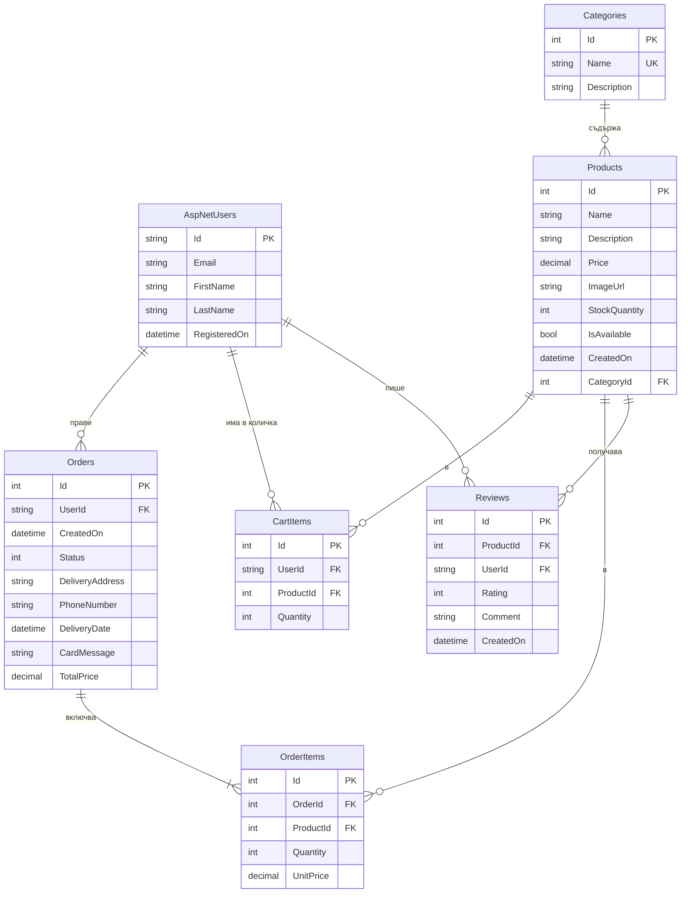

# База данни – начална версия (Етап 1)

СУБД: MS SQL Server. Подход: Code First с Entity Framework Core. Таблиците на ASP.NET Core Identity (`AspNetUsers`, `AspNetRoles`, `AspNetUserRoles` и др.) се добавят автоматично; `AspNetUsers` е разширена с `FirstName`, `LastName`, `RegisteredOn`.

## ER диаграма



## Основни правила

- `Categories.Name` е уникално.
- В `CartItems` двойката (`UserId`, `ProductId`) е уникална – един продукт се среща веднъж в количката.
- В `Reviews` двойката (`ProductId`, `UserId`) е уникална – един отзив на потребител за продукт.
- `OrderItems.UnitPrice` пази цената към момента на поръчката.
- Връзките към `Products` от `OrderItems` и към `AspNetUsers` от `Orders` са с `Restrict`, за да не се губи историята на поръчките.
- Паричните стойности са `decimal(18,2)`.

## Създаване и обновяване

```bash
dotnet ef migrations add InitialCreate --project src/FlowerShop.Data --startup-project src/FlowerShop.Web
dotnet ef database update --project src/FlowerShop.Data --startup-project src/FlowerShop.Web
```

Началният каталог (4 категории, 8 продукта), ролите и администраторът се създават от `DbSeeder` при първо стартиране.
